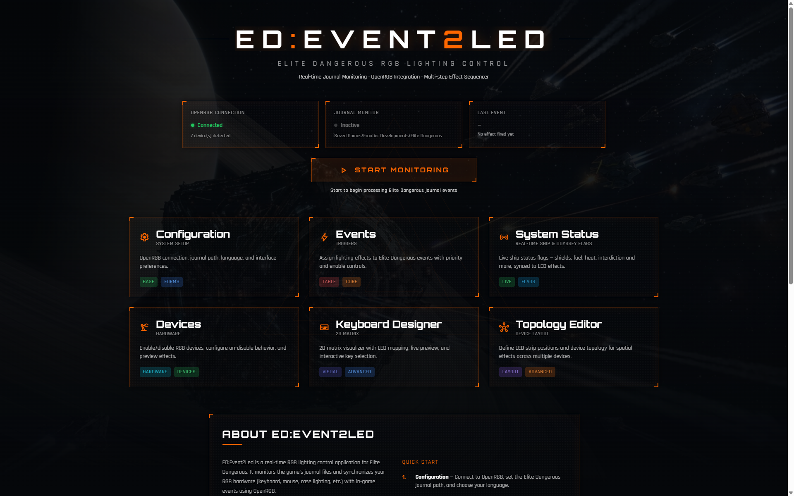
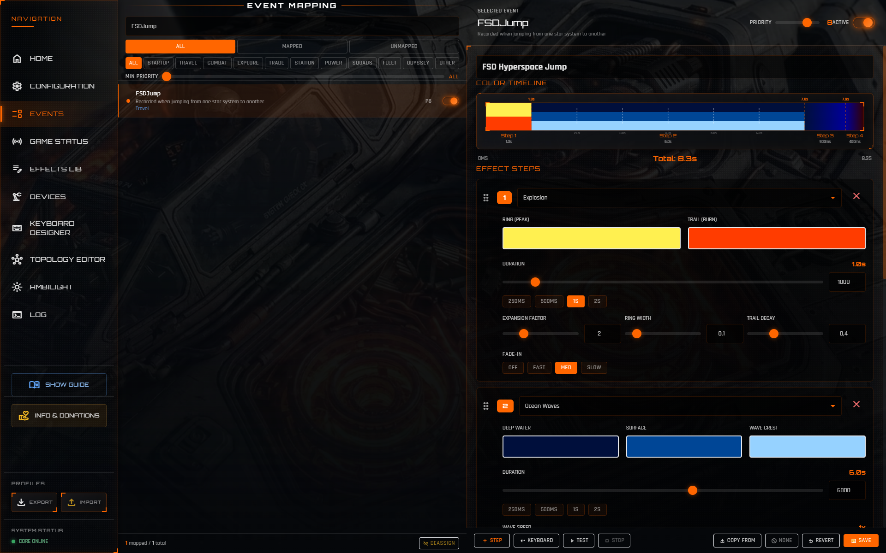
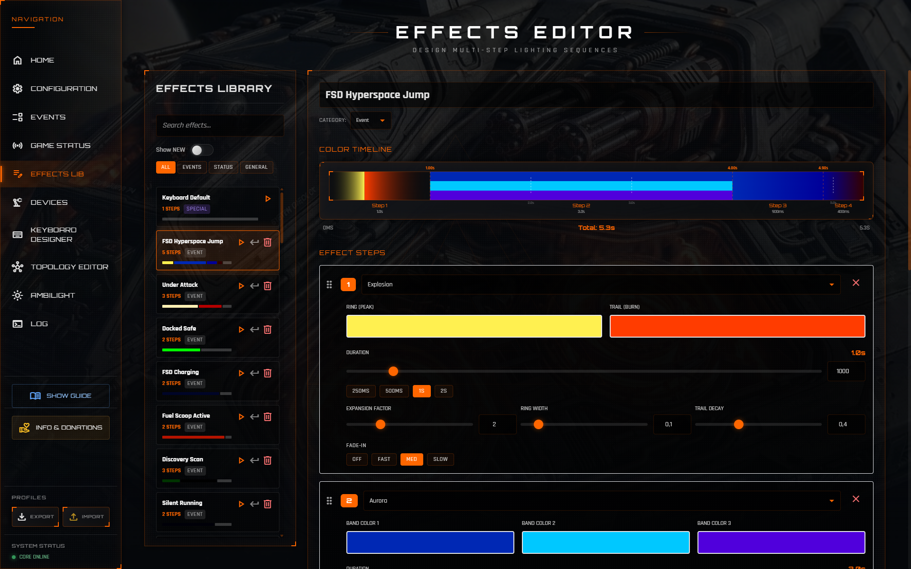
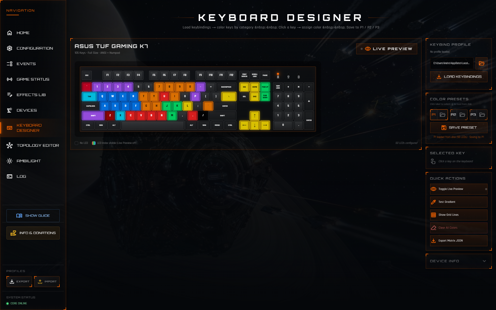
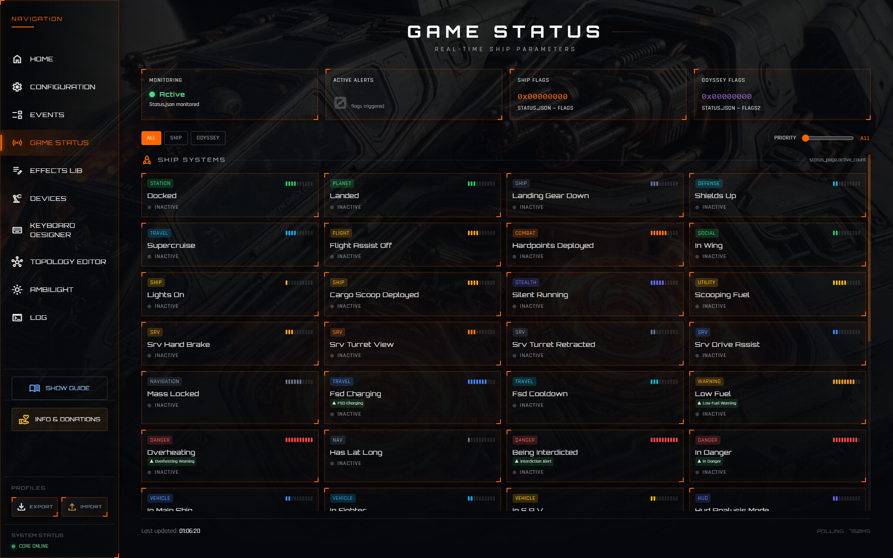
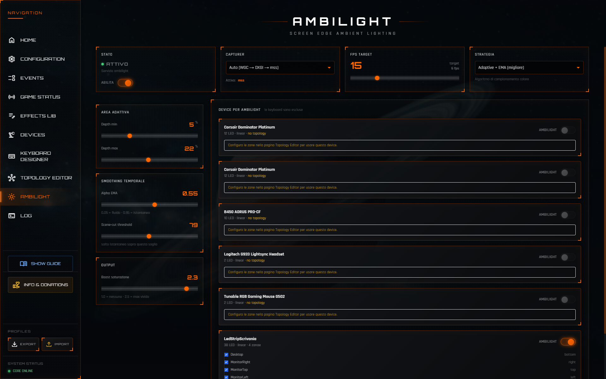
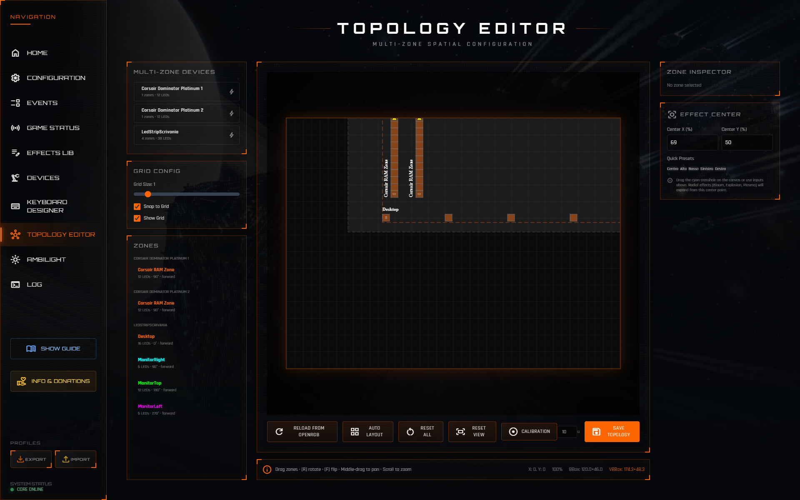

# ED:Event2Led

> Real-time RGB lighting synchronization for **Elite Dangerous**

ED:Event2Led monitors the game's journal files and synchronizes your RGB hardware with in-game events — FSD jumps, combat alerts, docking, heat warnings, and much more.




---

## 📥 Download

👉 **[Latest Release — v1.0](../../releases/latest)**

Extract the zip, double-click `EDEvent2Led.exe`. No installer needed.

---

## ✨ Features

### Event → LED Mapping
Map any Elite Dangerous journal event to a custom RGB effect. Each mapping has a priority level so simultaneous events resolve correctly.



### 17 Primitive Effects
Build complex lighting sequences by chaining multiple effect steps:

<table>
<tr><td><b>Static Transition</b></td><td>Smooth fade to a target color</td></tr>
<tr><td><b>Breath</b></td><td>Oscillate between two colors</td></tr>
<tr><td><b>Color Cycle</b></td><td>Animated color bands with 8-way direction</td></tr>
<tr><td><b>Wave</b></td><td>Directional wave propagation</td></tr>
<tr><td><b>Bump</b></td><td>Bidirectional bounce wave</td></tr>
<tr><td><b>Glitch</b></td><td>Random LED flicker with persistence</td></tr>
<tr><td><b>Fire</b></td><td>Cellular automata fire simulation</td></tr>
<tr><td><b>Matrix Rain</b></td><td>Falling character column effect</td></tr>
<tr><td><b>Ocean Waves</b></td><td>Superimposed sinusoidal waves</td></tr>
<tr><td><b>Plasma</b></td><td>2D sinusoid HSV palette cycling</td></tr>
<tr><td><b>Aurora</b></td><td>Vertical light bands with shimmer</td></tr>
<tr><td><b>Parallax Stars</b></td><td>Lateral star scroll with depth layers</td></tr>
<tr><td><b>Lightning</b></td><td>Discrete lightning strike events</td></tr>
<tr><td><b>Explosion</b></td><td>Concentric expanding circles</td></tr>
<tr><td><b>Two Color Nuance</b></td><td>Spatial gradient between 2 colors</td></tr>
<tr><td><b>Four Corner Nuance</b></td><td>4-corner 2D color interpolation</td></tr>
<tr><td><b>Keyboard Mapping</b></td><td>Restore keyboard to a saved color preset</td></tr>
</table>



### Keyboard Designer
Per-key color editor with 3 preset slots (P1/P2/P3). Optional keyboard lock prevents game effects from overriding the preset while active.



### Game Status Monitor
Live dashboard of Elite Dangerous `Status.json` flags — shields, hardpoints, heat, landing gear, supercruise, on-foot mode, and more.



### Ambilight
Synchronize LED strips with your monitor in real-time. Supports screen edge zones (left, right, top, bottom) with adaptive sampling, temporal smoothing, and saturation boost.



### Topology Editor
Visual pan/zoom editor for defining your LED strip layout in world space. Supports linear strips with zone mapping for spatial effects and ambilight.



### Multi-Language UI
Interface available in: 🇮🇹 Italian · 🇬🇧 English · 🇩🇪 German · 🇪🇸 Spanish · 🇫🇷 French

---

## 🔧 Requirements

| Requirement | Notes |
|-------------|-------|
| Windows 10 / 11 x64 | Required |
| [OpenRGB](https://openrgb.org/) | Must be running with SDK Server enabled |
| Elite Dangerous | For live journal monitoring |

> **OpenRGB SDK Server:** Open OpenRGB → Settings → Enable SDK Server → Start Server  
> Default port: `6742`

---

## 🚀 Quick Start

1. **Download** `ED-Event2Led-v1.0-win64.zip` from [Releases](../../releases/latest)
2. **Extract** to any folder (e.g. `C:\Games\EDEvent2Led\`)
3. **Start OpenRGB** and enable the SDK Server
4. **Double-click** `EDEvent2Led.exe`
5. The app opens your browser at `http://localhost:8000`

That's it. No Python installation needed — everything is bundled.

---

## 🎮 How It Works

```
Elite Dangerous
    │
    │  writes journal events to
    ▼
Journal files (*.log)
    │
    │  watched by
    ▼
ED:Event2Led
    │  matches events to mappings
    │  renders the assigned visual effect
    ▼
OpenRGB SDK Server
    │
    │  sends color data to
    ▼
Your RGB hardware
```

### Setting Up Event Mappings

1. Go to **Effects** and create a visual effect (or use a built-in one)
2. Go to **Events** and find the game event you want to react to
3. Click **Assign** and pick your effect + priority
4. Enable the mapping and start monitoring

---

## ⚙️ Configuration

All user configuration is stored in the `config/` folder next to the `.exe`:

| File | Contents |
|------|----------|
| `settings.json` | OpenRGB host/port, journal directory, language, web port |
| `event_mappings.json` | Your event→effect assignments |
| `visual_effects.json` | Your saved effects library |
| `keyboard_presets.json` | Keyboard color presets P1/P2/P3 |
| `ambilight_config.json` | Ambilight zones and capture settings |

> **Tip:** Back up the `config/` folder before updating to a new version to preserve your customizations.

### Custom Port

If port `8000` is already in use on your system, add this to `config/settings.json`:

```json
{
  "web_port": 8081
}
```

---

## 🖥️ Supported Hardware

ED:Event2Led works with any hardware supported by **OpenRGB**. This includes keyboards, mice, mousepads, RAM, GPU RGB, case lighting, and LED strips from:

ASUS, Corsair, Razer, Logitech, MSI, Gigabyte, NZXT, SteelSeries, HyperX, and [many more](https://openrgb.org/devices.html).

---

## 🔍 Troubleshooting

**The app doesn't connect to OpenRGB**  
→ Make sure OpenRGB is running and SDK Server is enabled (Settings → Enable SDK Server → Start).  
→ The app retries automatically every time you visit a page — no restart needed.

**Port 8000 is already in use**  
→ Set a custom port in `config/settings.json` (see Configuration above).

**Journal monitoring doesn't detect events**  
→ Verify the journal directory in Settings points to your Elite Dangerous logs folder.  
→ Default path: `%USERPROFILE%\Saved Games\Frontier Developments\Elite Dangerous\`

**Ambilight flickers or shows wrong colors**  
→ Try switching the capture mode in the Ambilight page (Auto / WGC / mss).  
→ Exclusive fullscreen in ED may require the DXGI capturer — install `dxcam` for best results.

**Something broke — how do I report it?**  
→ Open the **Logs** page inside the app and include the log output in your bug report.

---

## 📁 Directory Structure (after extraction)

```
EDEvent2Led/
├── EDEvent2Led.exe        ← launch this
├── config/                ← your settings (edit freely)
│   ├── settings.json
│   ├── event_mappings.json
│   ├── visual_effects.json
│   ├── keyboard_presets.json
│   └── ambilight_config.json
├── web/                   ← UI files (do not modify)
├── _internal/             ← Python runtime (do not modify)
└── README.txt             ← quick start guide
```

---

## 🔄 Updating

1. Download the new release zip
2. Extract to a **new folder** (e.g. `EDEvent2Led-v1.1\`)
3. Copy your `config\` folder from the old installation into the new folder
4. Launch the new `EDEvent2Led.exe`

---

## 📄 License

This software is distributed as a compiled binary. The source code is not publicly available at this time.

ED:Event2Led is **freeware**: free to use for personal, non-commercial purposes (streaming or recording your gameplay is fine, including on monetized channels).

You may **not** sell it, use it commercially, or redistribute it anywhere other than the [official release page](https://github.com/leandor70/EDEvent2Led/releases).

See the [LICENSE](LICENSE) file for the full terms.

---

*Made with ❤️ for the Elite Dangerous community*
